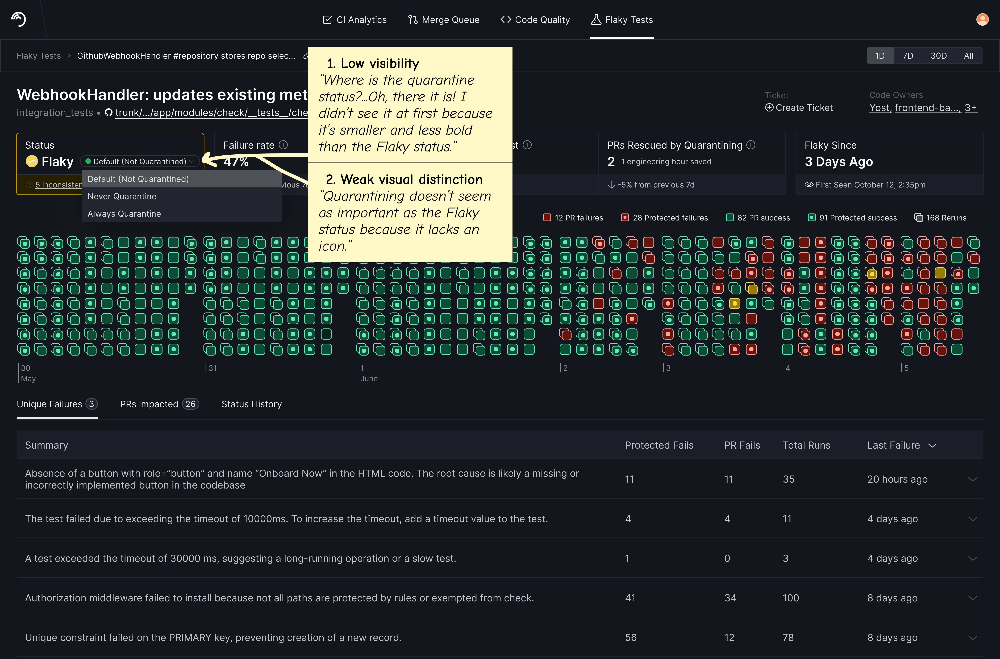
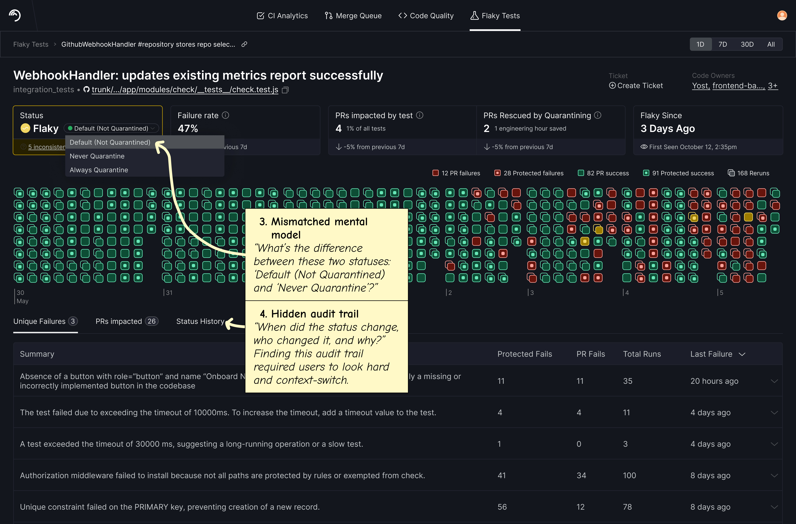
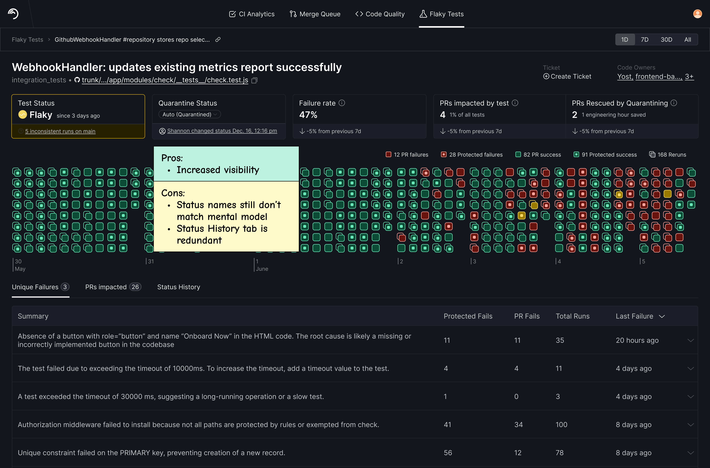
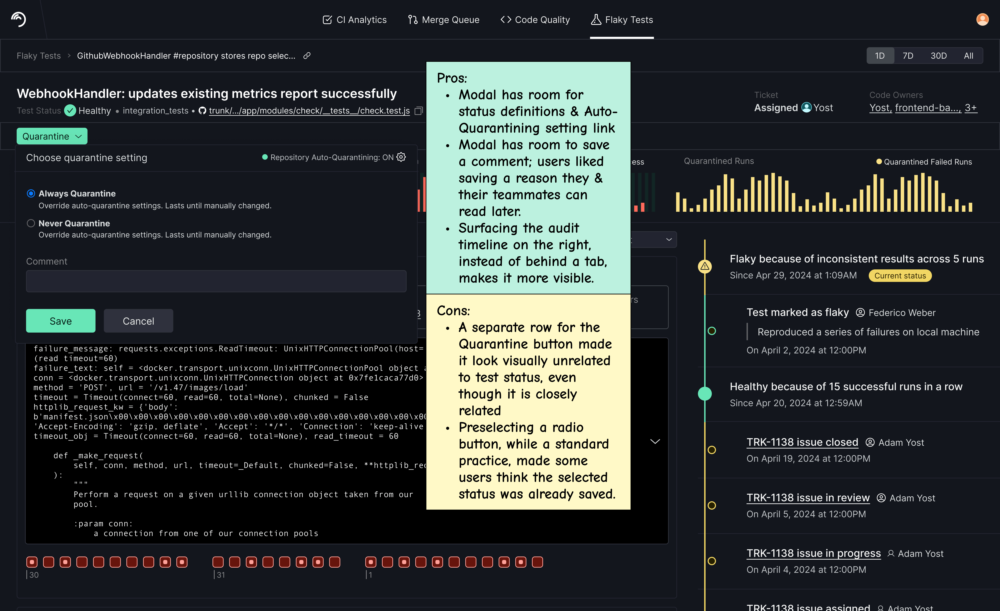
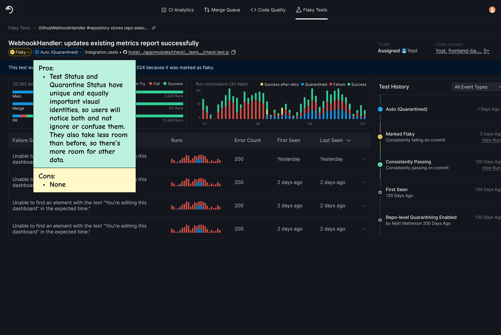
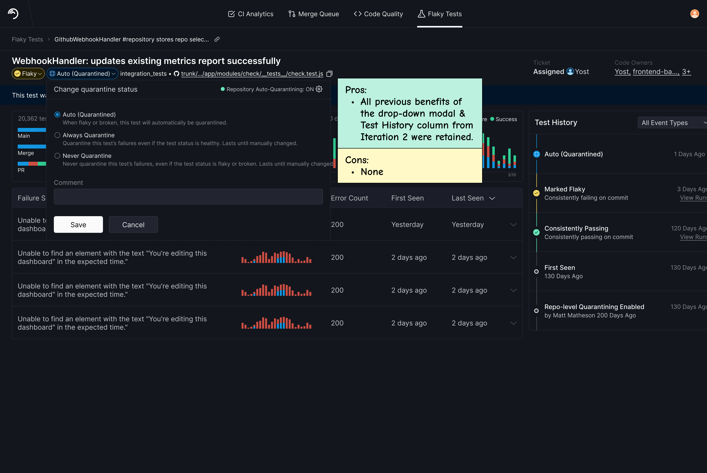

 
## TL;DR
 
At Trunk, we introduced a paid feature called Quarantining, and it had low adoption. To find out why, I did 5 user interviews, competitive analysis, and 8 usability tests. I discovered four issues: low visibility, weak visual distinction, a mismatched mental model, and no audit trail (timeline of when the status changed, who changed it, and why).
 
I redesigned the quarantine feature with increased visibility, a simplified mental model, and a way for users to save and view why the status changed. My designs shipped to production and passed customer usability tests.

[New Design Prototype](https://www.figma.com/proto/83LQuuuuvAgFsw9J2yU0xa/Quarantining?page-id=1%3A302581&node-id=7-293319&viewport=989%2C307%2C0.03&t=NwHraBw9j9vPPnB3-1&scaling=min-zoom&content-scaling=fixed&starting-point-node-id=7%3A293319&show-proto-sidebar=1)
 
## Four Problems in the Original Design

## Iterations
 
After looking at similar products and running sketching exercises, I tested these iterations internally and with customers.
 
## 1: Card View

My first proposal was the closest to the original design; I prioritized ease of implementation and didn't create any new components.
 

## Iteration 2: Action Row and Drop-down Modal

As I was iterating on the Quarantining feature, another designer finished a dashboard redesign, which unblocked me in a big way; I didn't need to keep the three tiles on the top right of the page anymore, so I decided it was worth experimenting with no tiles at all to save space. With so much more freedom, I could use an idea I'd saved from another similar product and I wanted to see if imitating it worked for us.
 

## Final Iteration: Compressed Drop-Down

Finally, I decided to question the design assumptions underpinning the original design; were cards taking more room than needed? Was an entire row needed for a quarantine button? I decided that we could achieve all necessary goals in less room. In this final version, the Test Status and Quarantine Status have unique and equally important visual identities, so users will notice both and not ignore or confuse them. They also take less room than before, so there’s more room for other data.

 
 
## Outcome
 
Our final customer validation came back clean: no task failures, no comprehension issues. Every contested element from earlier rounds — the hidden status history, the confusing status names, the preselection trap — was resolved.
 
The designs shipped to production. I left the company after launch but before usage data came in. What the design work established: usability issues were no longer a barrier to usage.